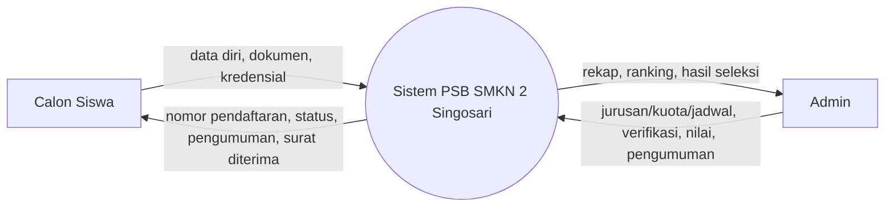
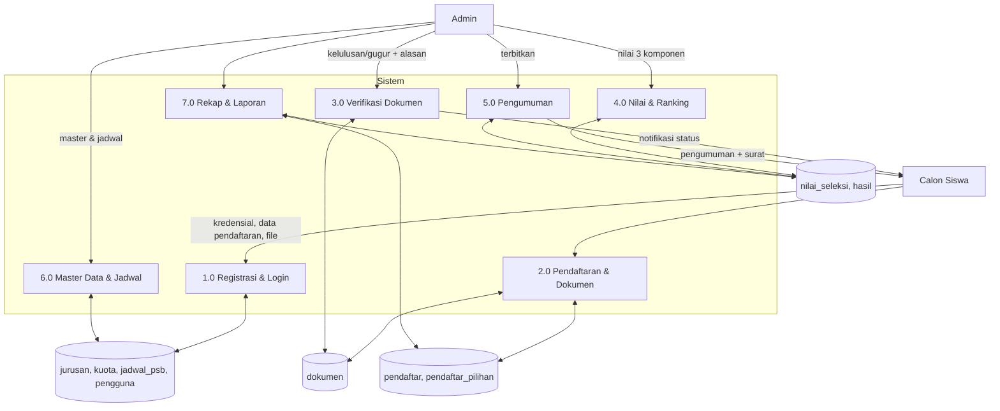
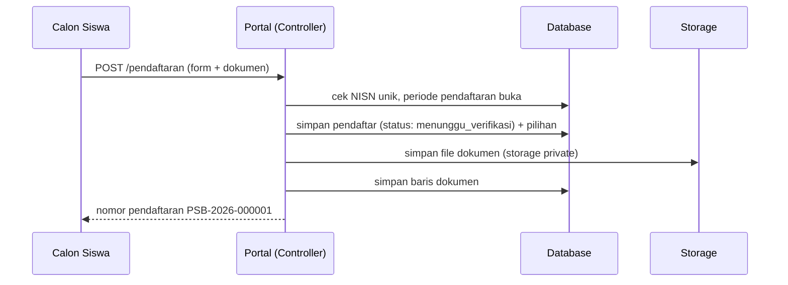
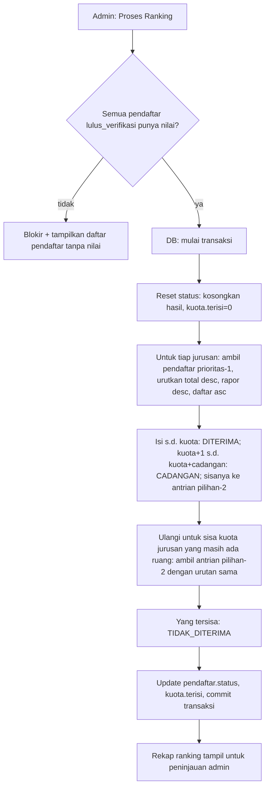

# System Design — Sistem PSB SMKN 2 Singosari

> Dokumen desain untuk Tugas Akhir. Berargumen dari `user-requirements.md`.
> Tech: Laravel 10 (PHP 8.1), Blade, Bootstrap 5 + template SB Admin 2 (sudah ada di repo), MySQL 8, jQuery (bawaan SB Admin 2).

## 1. Arsitektur Sistem

Arsitektur web 3-tier klasik:

```mermaid
flowchart LR
    subgraph Klien
        A[Browser Calon Siswa / Publik]
        B[Browser Admin]
    end
    subgraph Server["Server (Laravel 10)"]
        C[Controller (HTTP)]
        D[Service: RankingService, NomorPendaftaranService, JadwalService]
        E[Model Eloquent]
        F[Storage: file dokumen]
    end
    G[(MySQL 8)]
    A --> C
    B --> C
    C --> D
    C --> E
    E --> G
    C --> F
```

Konvensi (mengikuti struktur Laravel default di repo):
- `app/Models` — model Eloquent; `app/Services` — logika ranking, nomor pendaftaran, jadwal.
- `app/Http/Controllers` — `Admin/*` untuk dashboard, `Portal/*` untuk calon siswa & publik.
- `resources/views` — `admin/`, `portal/`, `public/`; layout: `admin/layout` (SB Admin 2), `portal/layout` (Bootstrap 5).
- `routes/web.php` — grup `/admin` (middleware `auth` + `role:admin`), grup portal, grup publik.
- File dokumen disimpan di `storage/app/private/dokumen/{nomor_pendaftaran}/`, diakses via controller terautorisasi (NFR-01).

## 2. DFD

### Level 0 (Context)



### Level 1



## 3. ERD

```mermaid
erDiagram
    PENGGUNA ||--o| PENDAFTAR : "memiliki (calon siswa)"
    PENDAFTAR ||--|{ PENDAFTAR_PILIHAN : "memilih 1-2"
    JURISAN ||--o{ PENDAFTAR_PILIHAN : "dipilih"
    JURISAN ||--|| KUITA : "memiliki"
    PENDAFTAR ||--|{ DOKUMEN : "mengunggah"
    PENDAFTAR ||--o| NILAI_SELEKSI : "dinilai"
    PENDAFTAR ||--o| HASIL : "diproses ranking"
    JURISAN ||--o{ HASIL : "tujuan diterima"
    JADWAL_PSB ||--o{ AUDIT_LOG : "menjangkau konteks"
    PENDAFTAR ||--o{ AUDIT_LOG : "objek perubahan"
    PENGGUNA ||--o{ AUDIT_LOG : "aktor"

    PENGGUNA {
        bigint id PK
        string name "nama lengkap"
        string email UK "login"
        string password "bcrypt hash"
        string nisn UK "10 digit, calon siswa"
        string role "calon_siswa | admin"
        string email_verified_at
        string status_aktif "1/0"
        datetime created_at
    }
    PENDAFTAR {
        bigint id PK
        string nomor_pendaftaran UK "PSB-YYYY-XXXXXX"
        bigint pengguna_id FK "null untuk manual"
        string sumber "online | manual"
        string nama_lengkap
        string tempat_lahir
        date tanggal_lahir
        string jenis_kelamin "L/P"
        string agama
        string asal_sekolah "SMP/MTs"
        string alamat
        string nik
        string nama_orang_tua
        string pekerjaan_orang_tua
        string telepon_orang_tua
        string status "draf|menunggu_verifikasi|lulus_verifikasi|gugur|diterima|cadangan|tidak_diterima"
        string alasan_gugur
        datetime dikirim_at
        datetime updated_at
    }
    JURISAN {
        bigint id PK
        string kode UK "mis. TKJ"
        string nama
        string deskripsi
        int rombel "kapasitas = rombel x 36"
        bool aktif
    }
    KUITA {
        bigint id PK
        bigint jurusan_id FK UK
        int kuota
        int cadangan "default 10% kuota"
        int terisi "diupdate saat ranking"
    }
    PENDAFTAR_PILIHAN {
        bigint id PK
        bigint pendaftar_id FK
        bigint jurusan_id FK
        int prioritas "1 | 2"
    }
    DOKUMEN {
        bigint id PK
        bigint pendaftar_id FK
        string jenis "ktp|kk|ijazah|rapor|foto"
        string path "storage private"
        string tipe_file
        int ukuran_bytes
        datetime diunggah_at
    }
    NILAI_SELEKSI {
        bigint id PK
        bigint pendaftar_id FK UK
        decimal nilai_rapor "0-100, bobot 0.4"
        decimal nilai_prestasi "0-100, bobot 0.3"
        decimal nilai_kunjungan "0-100, bobot 0.3"
        decimal total "otomatis"
        datetime diinput_at
    }
    HASIL {
        bigint id PK
        bigint pendaftar_id FK UK
        bigint jurusan_id FK "jurusan diterima, null jika tidak"
        int perankingan
        string status_akhir "diterima|cadangan|tidak_diterima"
        string via_pilihan "1|2"
        datetime diproses_at
    }
    JADWAL_PSB {
        bigint id PK
        string tahap "pendaftaran|verifikasi|perbaikan|seleksi|pengumuman"
        datetime mulai
        datetime selesai
    }
    AUDIT_LOG {
        bigint id PK
        bigint pengguna_id FK "aktor, null=sistem"
        string target "pendaftar:123"
        string aksi "verifikasi|nilai|publish|edit"
        json detail
        datetime created_at
    }
```

## 4. Struktur Tabel (DDL ringkas)

| Tabel | Field utama | Catatan |
|-------|-------------|---------|
| `users` (Laravel default → dipakai sebagai `PENGGUNA`) | id, name, email (unique), password, nisn (unique, nullable), role (enum: calon_siswa, admin), email_verified_at, timestamps | Role default `calon_siswa`; admin dibuat seeder |
| `jurusan` | id, kode (unique), nama, deskripsi (text), rombel (int), aktif (bool), timestamps | Kapasitas = rombel × 36 (helper) |
| `kuota` | id, jurusan_id (FK unique), kuota (int), cadangan (int), terisi (int default 0) | 1:1 jurusan |
| `pendaftar` | id, nomor_pendaftaran (unique), pengguna_id (FK nullable), sumber (enum), data diri & orang tua (kolom per ERD), status (enum), alasan_gugur (nullable), dikirim_at (nullable), timestamps | Index: status, nomor_pendaftaran, tanggal_lahir |
| `pendaftar_pilihan` | id, pendaftar_id (FK), jurusan_id (FK), prioritas (1,2), unique(pendaftar_id, prioritas) | Max 2 baris per pendaftar |
| `dokumen` | id, pendaftar_id (FK), jenis (enum), path, tipe_file, ukuran_bytes (int), diunggah_at, unique(pendaftar_id, jenis) | Ganti file = update baris yang sama |
| `nilai_seleksi` | id, pendaftar_id (FK unique), nilai_rapor, nilai_prestasi, nilai_kunjungan, total, diinput_at, timestamps | total = 0.4r + 0.3p + 0.3k (dihitung di service) |
| `nilai_seleksi_riwayat` | id, nilai_seleksi_id (FK), snapshot (json), diubah_oleh (FK users), changed_at | Append-only |
| `hasil` | id, pendaftar_id (FK unique), jurusan_id (FK nullable), perankingan, status_akhir (enum), via_pilihan, diproses_at | Dibuat ulang per proses ranking (delete+insert dalam transaksi) |
| `jadwal_psb` | id, tahap (unique), mulai, selesai | 5 baris tetap |
| `audit_log` | id, pengguna_id (FK nullable), target, aksi, detail (json), created_at | Index: target, created_at |

## 5. Alur Proses Utama (sequence)

### 5.1 Pendaftaran oleh calon siswa



### 5.2 Ranking & penetapan (inti sistem)



Aturan detail (dipakai `RankingService::proses()`):
1. Hanya pendaftar `status = lulus_verifikasi` yang ikut; yang `gugur` tidak ikut dan tetap `gugur`.
2. Antrian pilihan 2 hanya diproses pada jurusan yang masih memiliki sisa kuota **setelah** tahap prioritas 1 selesai.
3. Pendaftar yang diterima di pilihan 2 → `via_pilihan = 2`, `hasil.jurusan_id` = jurusan pilihan 2.
4. Cadangan tidak mengurangi kuota (`terisi` hanya untuk DITERIMA).
5. Tie-break deterministik: `total DESC, nilai_rapor DESC, pendaftar.dikirim_at ASC, id ASC`.
6. Hasil disimpan di tabel `hasil` saat proses ranking; **status pendaftar baru diterapkan
   saat pengumuman diterbitkan** (`PengumumanService::terbitkan()`) agar hasil tidak bocor
   sebelum pengumuman resmi. Pengumuman mensyaratkan hasil ranking sudah ada.

## 6. Desain Layar & Wireframe

Konvensi wireframe: `[ ]` input, `( )` radio, `{ }` select, `<>` tombol, `(o)` logo, garis = pemisah.

### 6.1 Portal publik

**S-PUB-01 Beranda PSB**
```
(o) Logo SMKN2 | Navigasi: Beranda | Alur | Jadwal | FAQ | [Daftar] [Cek Status]
+--------------------------------------------------------------+
|  Penerimaan Siswa Baru 2026/2027        Periode: 1 Jun–31 Jul |
|  [Banner sekolah]  7 Program Keahlian • Akreditasi A         |
+--------------------------------------------------------------+
| [Alur Pendaftaran 4 langkah: 1 Daftar → 2 Isi Form & Dokumen |
|  → 3 Verifikasi & Seleksi → 4 Pengumuman]                     |
| [Daftar Jurusan: kartu 7 jurusan + sisa kuota]                |
| [Kalender PSB per tahap]  [FAQ accordion]                     |
```

**S-PUB-02 Form Pendaftaran (3 langkah, satu halaman, tab)**
```
+--------------------------------------------------------------+
| LANGKAH 1: Data Diri     [====]  2: Orang Tua  3: Pilihan &  |
|                                   Dokumen  [Kirim]           |
| Nama lengkap [________________]   Tgl lahir [____] (mm/bb/tt)|
| T. lahir [________]  JK (L)(P)    Agama {____}               |
| NISN [__________] 10 digit, real-time cek unik               |
| Asal sekolah [________________]  Alamat [________________]   |
| NIK [______________]                                         |
| LANGKAH 2: Nama ortu [____] Pekerjaan [____] Telp [____]     |
| LANGKAH 3: Pilihan 1 {jurusan} sisa kuota: 72                |
|          Pilihan 2 {opsional}                                |
| Unggah: KTP [choose file] • KK [___] • Ijazah [___]          |
|         Rapor [___] • Foto 3x4 [___]  (PDF/JPG/PNG ≤ 2MB)    |
| [Simpan Draf]   [Kirim Pendaftaran]                          |
```

**S-PUB-03 Cek Status Publik** — input `No. Pendaftaran` + `Tanggal Lahir` → kartu status (untuk pendaftar manual).

### 6.2 Portal calon siswa (login)

**S-CS-01 Dashboard** — kartu: nomor pendaftaran, status per dokumen (✓/✗ 5 item), status verifikasi (badge), status akhir; tombol [Revisi] (aktif saat draf/perbaikan), [Cetak Surat] (aktif saat diterima).

**S-CS-02 Pengumuman/Hasil** — status akhir; jika diterima: jurusan, ranking, no. induk sementara; tombol [Cetak Surat Keterangan Diterima] (view `surat` → print/PDF).

### 6.3 Dashboard admin (SB Admin 2)

Sidebar: Dashboard | Pendaftar | Verifikasi | Nilai & Ranking | Jurusan & Kuota | Jadwal | Pengumuman | Laporan | Audit Log.

**S-AD-01 Dashboard** — 4 kartu statistik (Total pendaftar, Menunggu verifikasi, Lulus verifikasi, Diterima); grafik line pendaftar/hari; tabel 7 jurusan: kuota vs terisi vs sisa.

**S-AD-02 Pendaftar (data table)** — filter: status { }, jurusan { }, cari [nama/NISN/no. pendaftaran]; kolom: no. pendaftaran, nama, NISN, pilihan 1, pilihan 2, status dokumen (5 titik), status, aksi [Detail] [Verifikasi]. Detail = tab: Data | Dokumen (preview) | Nilai | Riwayat (audit).

**S-AD-03 Verifikasi** — daftar menunggu verifikasi; aksi per baris: [Lulus] / [Gugur + modal alasan].

**S-AD-04 Nilai & Ranking** — atas: [Proses Ranking] (confirm) + [Terbitkan Pengumuman] (disabled sampai proses selesai); tabel: nama, pilihan 1, rapor, prestasi, kunjungan, total (auto), ranking, status akhir. Inline edit 3 kolom nilai (simpan per baris, riwayat otomatis).

**S-AD-05 Jurusan & Kuota** — tabel 7 jurusan + edit kuota/cadangan/rombel; nonaktifkan (bukan hapus) jika sudah ada pendaftar.

**S-AD-06 Jadwal** — 5 baris tahap, date picker mulai/selesai; indikator tahap aktif.

**S-AD-07 Pengumuman** — status pengumuman (belum/terbit + timestamp), rekap per jurusan, [Terbitkan] / [Arsipkan Siklus].

**S-AD-08 Laporan** — filter + [Ekspor CSV] [Ekspor Excel]; tabel ringkasan per jurusan.

**S-AD-09 Audit Log** — tabel: waktu, aktor, aksi, target, detail (json ringkas).

## 7. Keamanan

- Middleware `role:admin` (custom) untuk grup `/admin`; portal calon siswa `auth` + role check.
- Upload: validasi ekstensi + MIME server-side, rename file `{uniqid}_{jenis}.{ext}`, simpan di luar `public/`, akses via `DokumenController@show` (admin) dengan streaming.
- Surat diterima: generated on-demand dari `hasil` + `pendaftar`, tanda tangan & stempel dari `config/psb.php`.
- Audit log untuk: verifikasi, input/ubah nilai, proses ranking, publish, edit pasca-publish.

## 8. Konfigurasi (`config/psb.php`)

```php
'nama_sekolah' => 'SMK Negeri 2 Singosari',
'alamat' => 'Jl. Perusahaan No. 20, Singosari, Kab. Malang',
'tahun_ajaran' => '2026/2027',
'siswi_per_rombel' => 36,
'bobot' => ['rapor' => 0.4, 'prestasi' => 0.3, 'kunjungan' => 0.3],
'jenis_dokumen' => ['ktp', 'kk', 'ijazah', 'rapor', 'foto'],
'link_verifikasi_expiry' => 7 * 24 * 60, // menit
'lock_login' => ['percobaan' => 3, 'durasi_menit' => 15],
```

## 9. Peta Layar → Route (ringkas)

| Route | Method | Halaman |
|-------|--------|---------|
| `/` | GET | S-PUB-01 |
| `/cek-status` | GET/POST | S-PUB-03 |
| `/register`, `/login`, `/logout`, `/verify-email/{token}` | — | auth publik |
| `/pendaftaran` (draf), `/pendaftaran/kirim` | GET/POST | S-PUB-02 (login CS) |
| `/status` | GET | S-CS-01 |
| `/surat/{nomor}` | GET | S-CS-02 / print |
| `/admin` | GET | S-AD-01 |
| `/admin/pendaftar` (+`/{id}`) | GET | S-AD-02 |
| `/admin/verifikasi`, `/admin/verifikasi/{id}/proses` | GET/POST | S-AD-03 |
| `/admin/nilai`, `/admin/nilai/{id}`, `/admin/ranking/proses` | GET/POST | S-AD-04 |
| `/admin/jurusan` (resource) | — | S-AD-05 |
| `/admin/jadwal` | GET/POST | S-AD-06 |
| `/admin/pengumuman`, `/admin/pengumuman/terbit` | GET/POST | S-AD-07 |
| `/admin/laporan` (+`/export/{format}`) | GET | S-AD-08 |
| `/admin/audit` | GET | S-AD-09 |

## 10. Seeder Data Awal

- 1 admin (`admin@smkn2.sch.id` / password via env `ADMIN_PASSWORD`, default `admin1234` untuk dev).
- 7 jurusan resmi: TKJ, RPL, ANM (Animasi), BCS (Broadcast), TAV, TEI, MKA (Mekatronika) — nama lengkap & deskripsi pendek; rombel awal: TKJ 3, RPL 3, ANM 2, BCS 2, TAV 2, TEI 2, MKA 2; kuota = rombel×36, cadangan = 10% (bulat atas).
- 5 baris `jadwal_psb` (nilai contoh 2026/2027).
- Factory untuk `pendaftar`, `dokumen` (file dummy), `nilai_seleksi` untuk uji ranking (skala 1000 pendaftar, NFR-02).
