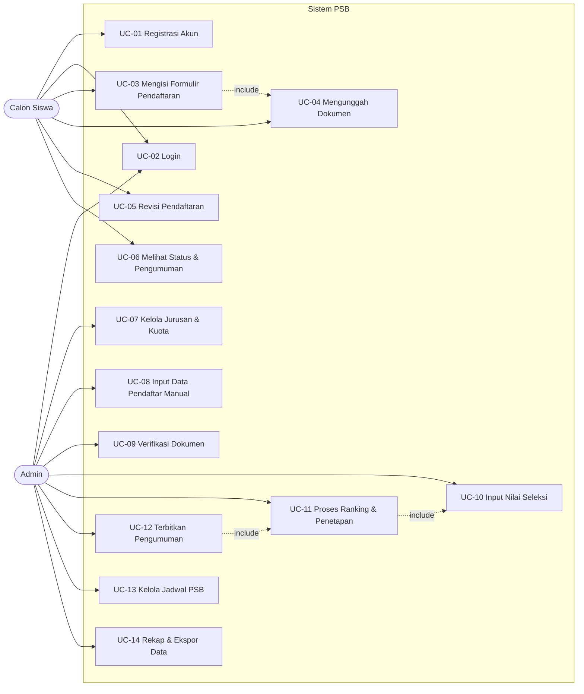

# User Requirements — Sistem Penerimaan Siswa Baru (PSB) SMKN 2 Singosari

> Dokumen analisis pengguna untuk Tugas Akhir: Sistem Informasi Penerimaan Siswa Baru
> berbasis web untuk SMK Negeri 2 Singosari (Jl. Perusahaan No. 20, Singosari, Kab. Malang).
> Dokumen pendamping: `system-design.md` (desain sistem) dan plan implementasi.

## 1. Latar Belakang

Proses Penerimaan Siswa Baru (PSB) SMKN 2 Singosari melibatkan ribuan pendaftar,
7 program keahlian dengan kuota terbatas, verifikasi dokumen, seleksi nilai, dan
pengumuman. Proses manual/sparse menyebabkan:

- antrean dan tumpukan berkas fisik saat puncak pendaftaran,
- sulitnya memverifikasi kelengkapan dokumen dan mendeteksi NISN ganda,
- proses ranking dan penetapan diterima/tidak yang lambat dan rawan kesalahan,
- calon siswa tidak bisa memantau status pendaftarannya secara mandiri.

Sistem ini dirancang sebagai aplikasi web yang menangani alur PSB dari
pendaftaran hingga pengumuman, dengan dua kelompok pengguna: calon siswa
(pendatang/portal publik) dan admin sekolah.

## 2. Tujuan Sistem

1. Memudahkan calon siswa mendaftar online, memilih jurusan, dan mengunggah dokumen.
2. Memudahkan admin mengelola data pendaftar, verifikasi dokumen, nilai seleksi,
   perankingan sesuai kuota, dan penerbitan pengumuman.
3. Memberikan transparansi status pendaftaran kepada calon siswa secara real-time.

## 3. Pengguna dan Role

| Role | Deskripsi | Akses |
|------|-----------|-------|
| **Calon Siswa** | Siswa lulusan SMP/MTs (atau diwakili orang tua/wali) yang mendaftar ke SMKN 2 Singosari | Portal publik: daftar akun, isi pendaftaran, upload dokumen, cek status & pengumuman |
| **Admin** | Panitia/staf PSB sekolah (1 role tunggal, tanpa sub-role) | Dashboard admin: kelola jurusan & kuota, data pendaftar, verifikasi, nilai, ranking, pengumuman, jadwal |

Catatan: Admin menggunakan akun yang dibuat oleh sekolah (bukan self-service).
Calon siswa membuat akun sendiri.

## 4. Alur Bisnis PSB

1. **Pembukaan PSB** — Admin menyiapkan data: jurusan (7 program keahlian),
   kuota per jurusan, dan jadwal (periode pendaftaran, verifikasi, seleksi, pengumuman).
   Portal pendaftaran hanya aktif di periode yang ditetapkan.
2. **Registrasi akun** — Calon siswa mendaftar akun dengan email + password dan
   mengisi NISN. Sistem memvalidasi keunikan NISN (1 NISN = 1 pendaftaran)
   dan keunikan email.
3. **Pendaftaran** — Calon siswa login, mengisi data diri, data orang tua,
   memilih maks. 2 jurusan (prioritas 1 dan 2), dan mengunggah dokumen
   persyaratan (KTP, KK, ijazah/surat kelulusan, rapor semester terakhir,
   foto 3x4). Sistem menerbitkan **nomor pendaftaran** otomatis.
4. **Revisi** — Selama periode pendaftaran masih buka, calon siswa boleh
   mengubah data/unggah ulang dokumen. Setelah ditutup, data terkunci.
5. **Verifikasi** — Admin memeriksa kelengkapan & kebenaran dokumen,
   menandai status: *lulus verifikasi* / *gugur* (dengan alasan).
6. **Seleksi** — Admin menginput nilai per komponen: nilai rapor (bobot 40%),
   prestasi (bobot 30%), kunjungan sekolah (bobot 30%). Sistem menghitung
   total nilai secara otomatis.
7. **Ranking & penetapan** — Sistem meranking pendaftar yang lulus verifikasi
   per jurusan pilihan 1; yang tidak terakomodasi (kuota penuh) turun ke
   pilihan 2 mengikuti ranking jurusan tersebut. Hasil: *Diterima* / *Cadangan*
   (sesuai batas cadangan per jurusan) / *Tidak Diterima*.
8. **Pengumuman** — Admin menerbitkan pengumuman. Calon siswa melihat status
   dan (jika diterima) mencetak **surat keterangan diterima**.
9. **Rekap** — Admin melihat rekap pendaftar per jurusan dan dapat mengekspor
   data (CSV/Excel) untuk laporan.

## 5. Diagram Use Case

## 6. Spesifikasi Use Case

### UC-01 Registrasi Akun (Calon Siswa)
| Item | Uraian |
|------|--------|
| Aktor | Calon Siswa |
| Precondition | Periode PSB terbuka; aktor belum memiliki akun |
| Trigger | Calon siswa menekan tombol "Daftar" di portal |
| Alur utama | 1. Isi email, password (min. 8 karakter, konfirmasi), NISN (10 digit). 2. Sistem memvalidasi format, keunikan email & NISN. 3. Sistem membuat akun, mengirim email konfirmasi berisi tautan verifikasi. 4. Calon siswa mengklik tautan, akun aktif, otomatis diarahkan ke login. |
| Alur alternatif | 3a. Email/NISN sudah terdaftar → tampilkan pesan error, akun tidak dibuat. 3b. Tautan verifikasi kedaluwarsa (7 hari) → minta minta kirim ulang. |
| Postcondition | Akun tersimpan (status *terverifikasi email*), calon siswa siap login. |

### UC-02 Login
| Item | Uraian |
|------|--------|
| Aktor | Calon Siswa, Admin |
| Precondition | Akun sudah terdaftar (admin dibuat pihak sekolah) |
| Alur utama | 1. Input email/username + password. 2. Sistem memverifikasi kredensial dan role. 3. Calon siswa diarahkan ke halaman pendaftaran/status; admin ke dashboard. |
| Alur alternatif | Kredensial salah → pesan error umum "email atau password salah" (tanpa menyebutkan field mana yang salah). 3x gagal → kunci sementara 15 menit. |
| Postcondition | Sesi login aktif (ber-token/session, expiry 24 jam, refresh manual via "Ingat saya"). |

### UC-03 Mengisi Formulir Pendaftaran (Calon Siswa)
| Item | Uraian |
|------|--------|
| Aktor | Calon Siswa |
| Precondition | Login sebagai calon siswa; periode pendaftaran masih dibuka; belum ada pendaftaran tersimpan/terkirim |
| Trigger | Menekan "Isi Pendaftaran" |
| Alur utama | 1. Isi data diri (nama lengkap, tempat/tgl lahir, jenis kelamin, agama, alamat, NISN, asalnya sekolah SMP/MTs asal). 2. Isi data orang tua/wali (nama, pekerjaan, no. telepon). 3. Pilih jurusan prioritas 1 (wajib) dan prioritas 2 (opsional) dari 7 program keahlian; sistem menampilkan sisa kuota. 4. Simpan draf (boleh beberapa kali selama periode buka). 5. Tekan "Kirim Pendaftaran". 6. Sistem memvalidasi kelengkapan → menerbitkan nomor pendaftaran (format `PSB-YYYY-XXXXXX`) → status pendaftaran = *Terverifikasi email, menunggu dokumen*. |
| Alur alternatif | 3a. Kuota pilihan 1 = 0 → pilihan tersebut tidak tersedia. 5a. Ada field wajib kosong/dokumen belum terunggah → form ditandai, submit ditolak dengan daftar field yang kurang. Periode pendaftaran ditutup saat submit → submit ditolak, data tersimpan sebagai draf. |
| Postcondition | Satu record pendaftaran per akun, berstatus menunggu verifikasi. |

### UC-04 Mengunggah Dokumen
| Item | Uraian |
|------|--------|
| Aktor | Calon Siswa |
| Precondition | Draf pendaftaran sudah ada (include dari UC-03) |
| Alur utama | 1. Unggah 5 dokumen: KTP calon siswa, KK, ijazah/surat kelulusan, rapor semester terakhir, foto 3x4. 2. Sistem memvalidasi tipe (PDF/JPG/PNG) dan ukuran maks. 2 MB per file. 3. File tersimpan di storage, status per dokumen = *terunggah*. |
| Alur alternatif | File melebihi limit / tipe salah → pesan error per file, file lama tetap. |
| Postcondition | Kelengkapan dokumen tercatat per item untuk verifikasi admin. |

### UC-05 Revisi Pendaftaran (Calon Siswa)
| Item | Uraian |
|------|--------|
| Aktor | Calon Siswa |
| Precondition | Status pendaftaran = *belum dikirim* ATAU *ditolak verifikasi* (boleh perbaikan); periode masih sesuai tahap |
| Alur utama | 1. Calon siswa membuka halaman revisi. 2. Mengubah data / mengganti file dokumen. 3. Kirim ulang → status kembali *menunggu verifikasi*. |
| Alur alternatif | Pendaftaran sudah *lulus verifikasi* atau periode ditutup → form read-only, tidak bisa diubah. |
| Postcondition | Data terbaru menggantikan data lama; jejak perubahan tercatat (timestamp). |

### UC-06 Melihat Status & Pengumuman (Calon Siswa)
| Item | Uraian |
|------|--------|
| Aktor | Calon Siswa |
| Precondition | Login; sudah memiliki nomor pendaftaran |
| Alur utama | 1. Halaman dashboard calon siswa menampilkan: nomor pendaftaran, jurusan pilihan, status per dokumen, status verifikasi, status seleksi, status akhir. 2. Jika pengumuman terbit: tampilkan *Diterima* (nama jurusan yang diterima, nomor induk sementara, tombol **Cetak Surat Keterangan Diterima**) / *Cadangan* / *Tidak Diterima* (dengan alasan singkat bila gugur verifikasi). |
| Alur alternatif | Pengumuman belum terbit → tampilkan "Menunggu pengumuman". |
| Postcondition | — (read-only) |

### UC-07 Kelola Jurusan & Kuota (Admin)
| Item | Uraian |
|------|--------|
| Aktor | Admin |
| Alur utama | 1. CRUD program keahlian: kode, nama, deskripsi, kapasitas kelas (rombel × 36), kuota PSB, jumlah cadangan (default 10% dari kuota), status aktif. 2. Sistem menampilkan rekap: kuota vs jumlah pendaftar vs terisi. |
| Alur alternatif | Jurusan yang sudah punya pendaftar tidak bisa dihapus, hanya dinonaktifkan. |
| Postcondition | Data jurusan & kuota dipakai oleh UC-03, UC-11, UC-14. |

### UC-08 Input Data Pendaftar Manual (Admin)
| Item | Uraian |
|------|--------|
| Aktor | Admin |
| Precondition | Login admin; periode pendaftaran dibuka |
| Alur utama | 1. Admin mengisi form pendaftar identik UC-03 + mengunggah dokumen dari file lokal. 2. Sistem menerbitkan nomor pendaftaran; pendaftar ditandai *sumber: manual* dan *status akun: tanpa login* (statusnya hanya bisa dilihat admin, atau dibagikan nomor pendaftarannya ke calon siswa untuk cek via halaman cek status publik). |
| Alur alternatif | NISN sudah terdaftar → ditolak. |
| Postcondition | Pendaftar masuk ke alur yang sama (verifikasi → seleksi → pengumuman). |

### UC-09 Verifikasi Dokumen (Admin)
| Item | Uraian |
|------|--------|
| Aktor | Admin |
| Precondition | Ada pendaftar berstatus *menunggu verifikasi*; periode verifikasi dibuka |
| Alur utama | 1. Admin membuka daftar pendaftar (filter: status, jurusan, NISN/nama/nomor pendaftaran). 2. Membuka detail + preview dokumen. 3. Menentukan hasil: *Lulus verifikasi* atau *Gugur* + alasan (misal "NIK tidak cocok dengan nama", "dokumen kabur"). 4. Status pendaftar diperbarui; calon siswa menerima notifikasi status di dashboard. |
| Alur alternatif | Pendaftar manual tanpa dokumen lengkap → admin boleh menandai *gugur* dengan alasan. |
| Postcondition | Pendaftar berstatus *lulus verifikasi* (masuk tahap seleksi) atau *gugur* (calon siswa boleh memperbaiki dan kirim ulang selama periode perbaikan dibuka). |

### UC-10 Input Nilai Seleksi (Admin)
| Item | Uraian |
|------|--------|
| Aktor | Admin |
| Precondition | Pendaftar berstatus *lulus verifikasi*; periode seleksi dibuka |
| Alur utama | 1. Admin membuka tabel nilai per pendaftar. 2. Input nilai per komponen (skala 0–100): nilai rapor, prestasi, kunjungan sekolah. 3. Sistem menghitung total = `rapor×0.4 + prestasi×0.3 + kunjungan×0.3` dan menyimpannya. 4. Input bisa diperbarui selama periode seleksi (nilai lama terekam sebagai riwayat). |
| Alur alternatif | Komponen prestasi tidak tersedia (tidak ada sertifikat) → diisi 0. |
| Postcondition | Nilai total tercatat; siap diproses ranking (UC-11). |

### UC-11 Proses Ranking & Penetapan (Admin trigger, sistem proses)
| Item | Uraian |
|------|--------|
| Aktor | Admin (menekan "Proses Ranking"), Sistem (menghitung) |
| Precondition | Semua pendaftar lulus verifikasi sudah memiliki nilai total; periode pengumuman dibuka |
| Alur utama | 1. Admin menekan tombol proses ranking. 2. Sistem meranking pendaftar per jurusan **pilihan 1** (nilai total desc, tie-break: nilai rapor desc, lalu tanggal daftar asc). 3. Pendaftar terisi s.d. kuota → *Diterima*; urutan (kuota+1) s.d. (kuota + cadangan) → *Cadangan*; sisanya lanjut ke **pilihan 2** dengan aturan yang sama pada sisa kuota pilihan 2. 4. Yang tidak terakomodasi kedua pilihan → *Tidak Diterima*. 5. Hasil ditampilkan di halaman rekap ranking; admin meninjau sebelum menerbitkan. 6. Proses bisa diulang selama pengumuman belum diterbitkan (nilai berubah → proses ulang). |
| Alur alternatif | Ada pendaftar tanpa nilai → sistem memblokir proses dan menampilkan daftarnya. |
| Postcondition | Status akhir setiap pendaftar tertentukan: *Diterima / Cadangan / Tidak Diterima* (+ jurusan diterima). |

### UC-12 Terbitkan Pengumuman (Admin)
| Item | Uraian |
|------|--------|
| Aktor | Admin |
| Precondition | Proses ranking (UC-11) sudah selesai & ditinjau |
| Alur utama | 1. Admin menekan "Terbitkan Pengumuman" + konfirmasi. 2. Status pengumuman = *terbit*; status pendaftar final terkunci (tidak bisa diubah nilai/ranking). 3. Halaman cek status calon siswa menampilkan hasil; surat keterangan diterima dapat dicetak. |
| Alur alternatif | Pengumuman sudah terbit → tombol disable; perubahan data hanya via admin dengan jejak audit (diperlakukan sebagai revisi manual, dicatat). |
| Postcondition | Siklus PSB untuk angkatan berjalan selesai; data siap rekap. |

### UC-13 Kelola Jadwal PSB (Admin)
| Item | Uraian |
|------|--------|
| Aktor | Admin |
| Alur utama | 1. Admin mengatur per tahap: periode pendaftaran (buka–tutup), verifikasi, perbaikan, seleksi, pengumuman (tanggal). 2. Sistem mengunci fitur sesuai tahap: form pendaftaran aktif hanya pada periode pendaftaran; submit ditolak setelah tutup (auto). |
| Postcondition | Seluruh fitur tunduk pada jadwal; kalender PSB tampil di portal publik. |

### UC-14 Rekap & Ekspor Data (Admin)
| Item | Uraian |
|------|--------|
| Aktor | Admin |
| Alur utama | 1. Dashboard rekap: total pendaftar, per jurusan (pendaftar/terima/cadangan/sisa kuota), grafik tren harian. 2. Ekspor daftar pendaftar & hasil (CSV dan Excel) dengan filter jurusan/status. |
| Postcondition | Laporan siap untuk arsip/dokumen resmi sekolah. |

## 7. Kebutuhan Fungsional

| Kode | Kebutuhan | Role |
|------|-----------|------|
| FR-01 | Autentikasi login berbasis email/username + password (bcrypt), sesi 24 jam, lock 15 menit setelah 3x gagal | CS, Admin |
| FR-02 | Registrasi akun calon siswa (email, password, NISN 10 digit) dengan validasi keunikan email & NISN + verifikasi email (tautan, expiry 7 hari) | CS |
| FR-03 | Form pendaftaran: data diri, data orang tua/wali, pilihan jurusan maks. 2 (prioritas 1 wajib, 2 opsional) dengan indikator sisa kuota | CS |
| FR-04 | Upload 5 dokumen (KTP, KK, ijazah/surat kelulusan, rapor, foto 3x4), tipe PDF/JPG/PNG, maks. 2 MB/file, bisa ganti sebelum terkirim | CS |
| FR-05 | Penerbitan nomor pendaftaran otomatis `PSB-YYYY-XXXXXX` unik per pendaftar | Sistem |
| FR-06 | Simpan draf + revisi data/dokumen selama periode pendaftaran atau tahap perbaikan; terkunci setelah lulus verifikasi / periode ditutup | CS |
| FR-07 | Halaman status pendaftar: nomor pendaftaran, status dokumen, status verifikasi, status seleksi, status akhir | CS |
| FR-08 | Halaman pengumuman + cetak surat keterangan diterima (PDF) untuk yang diterima | CS |
| FR-09 | CRUD program keahlian: kode, nama, deskripsi, rombel (×36 siswa/rombel), kuota, cadangan (default 10% kuota), status aktif | Admin |
| FR-10 | Input pendaftar manual (offline) oleh admin, sumber data ditandai, NISN tetap divalidasi unik | Admin |
| FR-11 | Daftar pendaftar dengan filter (status, jurusan, teks: nama/NISN/no. pendaftaran) + detail & preview dokumen | Admin |
| FR-12 | Verifikasi dokumen: lulus / gugur + alasan; pendaftar gugur bisa perbaiki & kirim ulang pada tahap perbaikan | Admin |
| FR-13 | Input nilai seleksi per komponen (rapor 0–100, prestasi 0–100, kunjungan 0–100) dengan bobot 40/30/30; total dihitung otomatis; riwayat nilai tersimpan | Admin |
| FR-14 | Proses ranking per jurusan (pilihan 1 → sisa ke pilihan 2), tie-break: nilai rapor desc, tanggal daftar asc; hasil: Diterima / Cadangan / Tidak Diterima | Sistem |
| FR-15 | Penerbitan pengumuman (final, terkunci) + notifikasi status ke dashboard calon siswa | Admin |
| FR-16 | Kelola jadwal PSB per tahap (pendaftaran, verifikasi, perbaikan, seleksi, pengumuman); penguncian fitur otomatis berdasarkan tanggal | Admin |
| FR-17 | Dashboard rekap: statistik per jurusan, grafik pendaftar harian, sisa kuota | Admin |
| FR-18 | Ekspor data pendaftar & hasil seleksi ke CSV/Excel dengan filter | Admin |
| FR-19 | Halaman portal publik: beranda info PSB, alur pendaftaran, kalender/periode, FAQ, tombol daftar & cek status (cek status publik: input no. pendaftaran + tanggal lahir) | Publik |

## 8. Kebutuhan Non-Fungsional

| Kode | Kebutuhan |
|------|-----------|
| NFR-01 | **Keamanan**: password di-hash bcrypt; seluruh route admin di-guard middleware role; upload divalidasi server-side (tipe + ukuran); proteksi CSRF & XSS (Laravel bawaan); file dokumen tidak bisa diakses publik tanpa otorisasi (except untuk admin) |
| NFR-02 | **Kinerja**: halaman respons < 3 detik pada 100 user bersamaan; proses ranking 1.000 pendaftar < 10 detik |
| NFR-03 | **Usability**: UI Bahasa Indonesia, responsive (mobile-first — mayoritas pendaftar dari HP), alur form maksimal 3 langkah dengan validasi inline |
| NFR-04 | **Ketersediaan**: uptime 99% pada periode PSB; backup database harian otomatis |
| NFR-05 | **Kompatibilitas**: Chrome, Edge, Firefox (2 versi terakhir); PHP 8.1+, Laravel 10, MySQL 8 |
| NFR-06 | **Audit**: setiap perubahan status penting (verifikasi, nilai, pengumuman, edit pasca-publish) tercatat actor + timestamp |
| NFR-07 | **Keandalan**: NISN unik dijaga constraint DB (bukan hanya validasi form); transaksi DB untuk proses ranking agar konsisten |

## 9. Entitas Data (tingkat tinggi)

`pengguna` (akun: calon siswa & admin, role), `pendaftar` (data pendaftar +
nomor pendaftaran + status), `pendaftar_pilihan` (prioritas 1 & 2), `dokumen`
(file per jenis + status), `jurusan`, `kuota` (kuota & cadangan per jurusan),
`nilai_seleksi` (per komponen + total + riwayat), `hasil` (status akhir +
jurusan diterima), `jadwal_psb` (per tahap), `audit_log`.
Detail struktur & relasi: lihat `system-design.md`.

## 10. Asumsi & Batasan

1. 7 program keahlian SMKN 2 Singosari: TKJ, RPL, Animasi, Broadcast
   (Produksi & Siaran Program TV), Teknik Audio Video, Teknik Elektronika
   Industri, Mekatronika.
2. Satu akun = satu pendaftar; satu NISN = satu pendaftaran seumur siklus PSB.
3. Tidak ada pembayaran online (SMK negeri, tanpa biaya pangkal) — di luar scope.
4. Tidak ada modul tryout online; nilai seleksi diinput manual oleh admin.
5. Satu role admin tunggal (tanpa sub-role panitia/kasek).
6. Pendaftar manual (offline) tidak memiliki akun; statusnya dicek lewat
   halaman cek status publik (nomor pendaftaran + tanggal lahir).
7. Siklus PSB tahunan; data setiap angkatan diarsipkan, tidak terhapus.
